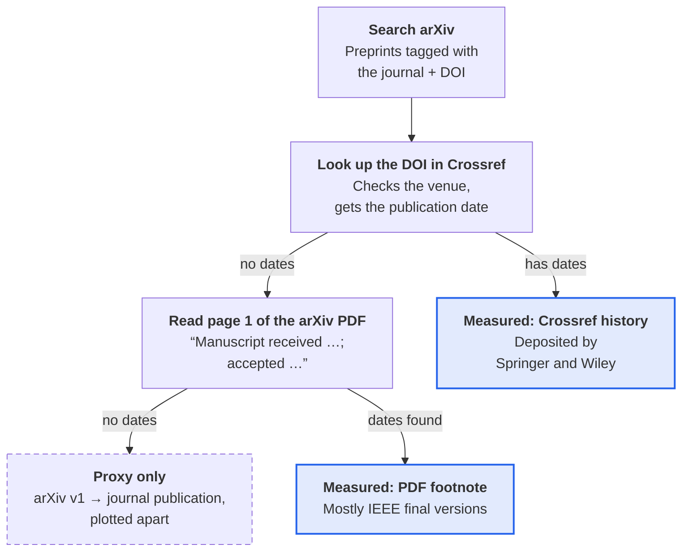

## Why review time deserves data

Picking a journal is a bet on time. A PhD student with a defense date, a postdoc on the job market, or a lab with a grant report due all need to know one thing: how long until this paper is accepted?

The usual answers are folklore. A labmate's story, a forum thread, or the "average time to first decision" a publisher puts on its homepage, which leaves out revision rounds. The real numbers already exist. Many journals print "Received / Accepted" dates on every paper. Nobody collects them in one place for the venues you are actually choosing between.

Paper Stats is a small tool that collects them for you.

## What Paper Stats does

You give it a list of journals and a year range. It returns, for each journal, how many days papers spent between "received" and "accepted", as a box plot, a summary table and a CSV.

It works in three steps:

- **Find papers.** It asks arXiv for recent preprints whose authors tagged them with the journal's name, and takes each one's DOI.
- **Get the dates.** It looks up each DOI in Crossref, the registry behind DOIs. Some publishers deposit the full article history there. For the others, it reads the "Manuscript received …; accepted …" footnote on the first page of the arXiv PDF.
- **Summarize.** It reports the median and interquartile range per journal, sorted fastest first, and links every data point to its paper so you can check it.

Every number traces back to a date the journal printed. When no such date exists, the tool says so instead of guessing.

## How it works



Each paper goes down the left column until a step finds its dates. Crossref also drops papers whose venue doesn't match the journal. Without that check, a search for _Robotics and Autonomous Systems_ also pulls in _Annual Review of Control, Robotics, and Autonomous Systems_.

The two measured sources are trusted the same: both are dates the publisher printed. The proxy is kept for journals that print nothing, but it is drawn as a separate box in every chart and never averaged with the real numbers.

## What a run found

I ran it on 12 robotics and automation journals, asking for 25 papers each published in 2022–2026. It kept 189 papers, and 69 of them had printed review dates: 36 from Crossref and 33 from PDF footnotes.

<script type="text/tikz">
\begin{document}
\begin{tikzpicture}[x=0.017cm,y=-0.8cm]
\definecolor{accent}{RGB}{37,99,235}
\definecolor{muted}{RGB}{140,140,140}
\definecolor{quiet}{RGB}{100,100,100}
\definecolor{gridc}{RGB}{222,222,222}
\foreach \d/\l in {0/0,90/3 mo,180/6 mo,270/9 mo,360/12 mo,450/15 mo,540/18 mo}{
  \draw[gridc] (\d,0.45) -- (\d,5.5);
  \node[above,font=\footnotesize,text=quiet] at (\d,0.45) {\l};
}
\node[anchor=east,font=\small\bfseries] at (-15,1) {IEEE Access};
\node[anchor=east,font=\small] at (-15,2) {IEEE Robotics and Automation Letters};
\node[anchor=east,font=\small] (jirs) at (-15,3) {Journal of Intelligent \& Robotic Systems};
\node[anchor=east,font=\small] at (-15,4) {Autonomous Robots};
\node[anchor=east,font=\small] at (-15,5) {Journal of Field Robotics};
\begin{scope}[line width=1.5pt]
\draw[accent] (19.5,1) -- (42.5,1) (19.5,0.87) -- (19.5,1.13) (42.5,0.87) -- (42.5,1.13);
\draw[muted] (106.25,2) -- (150.75,2) (106.25,1.87) -- (106.25,2.13) (150.75,1.87) -- (150.75,2.13);
\draw[muted] (156,3) -- (233,3) (156,2.87) -- (156,3.13) (233,2.87) -- (233,3.13);
\draw[muted] (229.25,4) -- (360,4) (229.25,3.87) -- (229.25,4.13) (360,3.87) -- (360,4.13);
\draw[muted] (192.75,5) -- (465,5) (192.75,4.87) -- (192.75,5.13) (465,4.87) -- (465,5.13);
\end{scope}
\fill[accent] (33,1) circle (3.5pt);
\fill[muted] (133,2) circle (3.5pt);
\fill[muted] (194,3) circle (3.5pt);
\fill[muted] (265.5,4) circle (3.5pt);
\fill[muted] (288.5,5) circle (3.5pt);
\node[anchor=west,font=\small\bfseries] at (52,1) {33 days $\cdot$ $n=11$};
\node[anchor=west,font=\small,text=quiet] at (158,2) {133 days $\cdot$ $n=16$};
\node[anchor=west,font=\small,text=quiet] at (240,3) {194 days $\cdot$ $n=13$};
\node[anchor=west,font=\small,text=quiet] at (367,4) {266 days $\cdot$ $n=10$};
\node[anchor=west,font=\small,text=quiet] at (472,5) {289 days $\cdot$ $n=12$};
\node[anchor=base west,font=\bfseries,inner xsep=0pt] at (jirs.west |- 0,-1.55) {Median review: 33 days at IEEE Access, 133 to 289 days elsewhere};
\node[anchor=base west,font=\footnotesize,text=quiet,inner xsep=0pt] at (jirs.west |- 0,-0.95) {Days from received to accepted $\cdot$ dot = median, bar = middle 50\% of papers $\cdot$ grid every 3 months};
\node[anchor=north west,font=\footnotesize,text=quiet,align=left,inner xsep=0pt] at (jirs.west |- 0,5.85) {Shown: the 5 journals with 10 or more measured papers, published 2022--2026.\\Not shown: T-RO, IJRR, T-ASE and Robotics and Autonomous Systems had 2 or fewer papers with printed dates.};
\end{tikzpicture}
\end{document}
</script>

With 10 to 16 papers per journal, read this as a first look, not a ranking. The spread matters as much as the median: at Journal of Field Robotics, the middle half of papers took anywhere from about 6 to 15 months.

Two results argue for using printed dates instead of arXiv dates:

- **Many authors post after acceptance.** Of the 36 papers dated through Crossref, 9 went on arXiv only after they were accepted. arXiv's own timestamps say nothing about their review.
- **The arXiv proxy misses in both directions.** Measured from first arXiv version to publication, Autonomous Robots looks like 638 days (measured review: 266) and RA-L like 92 days (measured: 133).

## Who it is for

- **PhD students and postdocs.** When a thesis defense or a job application needs the paper accepted by a set date, the median and spread show which journals can realistically make it.
- **Supervisors.** It is a quick, sourced answer to "where should this go?" that you can show a student, instead of "in my experience".
- **Editors and editorial boards.** It benchmarks your journal against the ones authors actually compare it with, using your own printed dates.
- **Meta-researchers.** The CSV holds per-paper dates and sources, ready to analyze, and the method is written up as a flowchart for a methodology section.

The journal list is a text file. Swap the robotics titles for your own field and the same pipeline runs.

## What it cannot tell you

- **It only sees papers on arXiv.** Labs that don't post preprints, or don't fill in the journal reference, are invisible to it. Accepted papers are also the only ones that ever get a "received" date, so rejections never show up.
- **Coverage depends on the publisher.** SAGE and Elsevier deposit no review dates in Crossref, and their preprints rarely carry them. For journals like IJRR and Robotics and Autonomous Systems, the tool falls back to the proxy. IEEE dates appear only when authors upload the final version: 16 of 25 RA-L papers had them, but only 2 of 25 T-RO papers.
- **"Received" can reset.** Some journals restart the clock after a reject-and-resubmit, so the printed time understates the real wait.
- **The proxy is a rough bound.** arXiv v1 to journal publication is short or negative when authors post after acceptance, and long when they post years before submitting. It is never mixed into the measured numbers.
- **Samples are recent-first.** Each journal's sample is its latest N usable papers, not a random draw over the year range.

## Try it at my [**repo**](https://github.com/lesaf92/paper_stats)

It is a small Python app with two dependencies, Flask and pypdf:

```bash
python3 -m venv venv
venv/bin/pip install -r requirements.txt
venv/bin/python server.py
```

Open http://127.0.0.1:5000, put your journals in `list_of_journals.txt`, set the sample size and year range in the Configuration tab, and press **Fetch Data & Run Analysis**.

The first run takes a while, because arXiv asks clients to wait 3 seconds between requests and the tool respects that. For the 12 journals above it took 32 minutes. Every lookup is cached, so the rerun took under 2 minutes. When it finishes, download the CSV and check any number against its paper.

If your field's journals print dates in a format the parser misses, the matching rules are a few lines in `collector.py`, with tests next to them.
