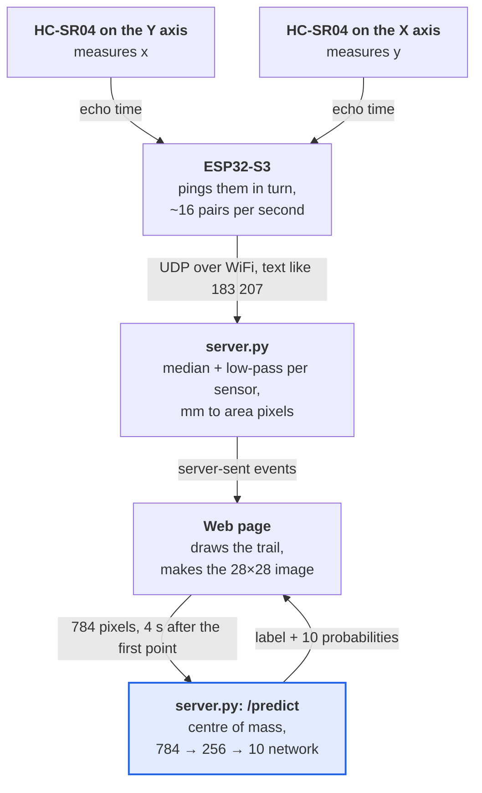

Move a pen through the air in front of two ultrasonic sensors and a web page draws its trail as you go. Four seconds after the first point, a neural network says which digit you wrote.


<div class="caption">
    The Ultrasonic tab after reading a 2. Left: the 10 cm drawing area, with its edges in mm. Right: the 28×28 image the network received and its probability for each digit. This trail came from a script that sends traced points as sensor readings (see <a href="#what-it-cannot-do-yet">What it cannot do yet</a>).
</div>

## Why build this

It's a teaching project. Every part is small: the firmware is 54 lines, the server 153, the training script 146, and the web page is one HTML file. Nothing hides in a library. The network is plain NumPy and the sensor readings travel as plain text, so a student can read every part in an afternoon, and every part has something to measure.

The project crosses four subjects that are usually taught apart:

- **Electronics:** time of flight, logic levels, a voltage divider, timing.
- **Networking:** WiFi, IP addresses, UDP ports, a firewall.
- **Signal processing:** noise, spikes, a median filter, a low-pass filter, and the lag each one costs.
- **Machine learning:** a dataset, a network trained from scratch, backpropagation by hand, overfitting, and what happens when real inputs don't look like the training data.

## The apparatus


<div class="caption">
    Two HC-SR04 sensors at right angles. The one on the Y axis measures the object's x, the one on the X axis measures its y. The object is tracked only where both ~15° beams overlap.
</div>

An HC-SR04 sends a burst of 40 kHz sound when its TRIG pin gets a 10 µs pulse, then holds its ECHO pin high until the echo comes back. The distance follows from the time the pin stays high, $$t$$, and the speed of sound, $$v$$:

$$
d = \frac{v\,t}{2}, \qquad v \approx 343\ \text{m/s at } 20\,^\circ\text{C}
$$

The sound goes there and back, hence the 2. That is about 5.8 µs of echo per millimetre, and it is all the firmware needs:

```cpp
int readMm(int trig, int echo) {
  digitalWrite(trig, HIGH);
  delayMicroseconds(10);
  digitalWrite(trig, LOW);
  // ~5.8 us of echo per mm of distance, plus up to ~3 ms before some modules raise ECHO
  unsigned long us = pulseIn(echo, HIGH, MAX_MM * 6 + 3000);
  return us ? us * 343 / 2000 : -1;  // sound at 343 m/s (20 °C), there and back
}
```

Three details of the circuit and the timing are worth a lesson each:

- **Logic levels.** The HC-SR04 runs on 5 V and so does its ECHO output, but the ESP32-S3's pins take 3.3 V. A divider with 1 kΩ from ECHO to the pin and 2 kΩ from the pin to ground brings it down to $$5 \times \frac{2}{1+2} \approx 3.3$$ V. TRIG works from 3.3 V as it is.
- **Crosstalk.** The two beams cross, so one sensor can hear the other's ping. The firmware pings them in turn and pauses 25 ms after each, which caps the rate at about 16 pairs of readings per second.
- **Beam width.** A beam about 15° wide is about 50 mm across at 200 mm, so the zone both sensors cover is small. I set the drawing area to 150–250 mm on both axes: a 10 cm square.

| HC-SR04 pin | ESP32-S3 (pins from `config.example.h`) |
|---|---|
| VCC | 5 V |
| GND | GND |
| TRIG | GPIO 4 for the x sensor, GPIO 6 for the y sensor |
| ECHO | GPIO 5 for the x sensor, GPIO 7 for the y sensor, each through the 1 kΩ + 2 kΩ divider |

## From the sensors to the browser



The ESP32 sends each pair of distances as one UDP packet of plain text, such as `183 207`, with `-1` for a sensor that heard no echo. UDP suits this: a lost packet is one missing point, and a late point is worse than none, so there is nothing worth sending again.

On the computer, `server.py` does three things with each packet.

**It smooths each sensor.** A still object doesn't give a still reading: on my bench, consecutive readings of an object that didn't move differed by 5.9 mm on average. Two filters fix most of it. A median of the last three readings drops a single bad ping, a spike or a missing echo. Then a low-pass filter, an exponential moving average, evens out the jitter that is left:

$$
\hat{x}_k = \hat{x}_{k-1} + \alpha\,(m_k - \hat{x}_{k-1}), \qquad \alpha = 0.5
$$

where $$m_k$$ is the median of the latest three readings and $$\hat{x}_k$$ the smoothed value.

```python
class Smoother:
    def __init__(self, median_of, low_pass):
        self.recent = deque(maxlen=median_of)
        self.weight = low_pass
        self.avg = None

    def __call__(self, reading):
        self.recent.append(reading)
        median = sorted(self.recent)[len(self.recent) // 2]
        if median < 0:
            self.avg = None
            return -1
        self.avg = median if self.avg is None else self.avg + self.weight * (median - self.avg)
        return round(self.avg)
```

The repo's self-test feeds it these readings, in mm:

| Readings | 100 | 100 | 900 | 100 | −1 | 100 | −1 | −1 |
|---|---|---|---|---|---|---|---|---|
| **Median of 3** | 100 | 100 | 100 | 100 | 100 | 100 | −1 | −1 |

The 900 mm spike and the single missing echo vanish. Two missing echoes in a row get through, because then the object really is gone.

| Readings | 100 | 200 | 200 | −1 | 300 |
|---|---|---|---|---|---|
| **Low-pass, α = 0.5** | 100 | 150 | 175 | −1 | 300 |

The low-pass moves halfway to each new reading, and starts over after a missing echo so that the next trail doesn't drift in from where the last one ended.

Together they cut the average step between readings of a still object from 5.9 to 2.0 mm. Neither is free. The median of three delays the point by one reading, about 60 ms, and the low-pass with α = 0.5 needs three readings to cover seven eighths of a sudden move. Both are set in `config.toml` (`median_of`, `low_pass`), and changing them while drawing is the quickest way to feel the trade between noise and lag.

**It maps millimetres to the drawing area.** The area is 480×480 px on the page. Distances between $$x_0 = 150$$ and $$x_1 = 250$$ mm map to 0–480 px from left to right, and the same for y, flipped, because y grows upwards on the apparatus and downwards on a screen:

$$
p_x = \frac{x - x_0}{x_1 - x_0}\,W, \qquad p_y = \left(1 - \frac{y - y_0}{y_1 - y_0}\right) H
$$

**It relays the point** to every open page over server-sent events: one long HTTP response that the browser reads line by line with `EventSource`.

## Drawing in the air

My first try at drawing with the sensors felt wrong in two ways. The dot jumped from reading to reading, 16 times a second, and I couldn't tell how big the area was or where its edges were. The Ultrasonic tab now deals with both.

<div class="row mt-3">
    <div class="col-sm mt-3 mt-md-0">
        
    </div>
    <div class="col-sm mt-3 mt-md-0">
        
    </div>
</div>
<div class="caption">
    Left: mid-stroke, the dot glides from one reading to the next and the trail follows it. Right: the pen left the area through the bottom; a ring waits on the edge and the text says how far to move back.
</div>

- **The dot glides.** Between two readings the dot moves in a straight line over the measured time between packets, and the trail is drawn as curves through the midpoints of its points instead of straight segments. Sixteen points a second then look like motion.
- **The edges are in millimetres.** The scale around the area matches the distances in `config.toml`, and the line under the title shows both live readings.
- **Leaving the area lifts the pen.** Outside the area the trail breaks, a ring stays on the nearest edge and the page says which way and how far to move back. Leaving is also how you start the next digit: after a read, a new trail starts only when the pen has left the area and come back.
- **The network sees the area as drawn**, without rescaling. More on this in [From trail to input](#from-trail-to-input).

## The network

The page's third tab, Model, describes the network that reads the digits. It reads everything from the model file, so it follows each retraining. This section goes through it in more depth.


<div class="caption">
    The top of the Model tab: the headline numbers, the layers and the accuracy after each epoch.
</div>

### The dataset: MNIST


<div class="caption">
    The first three test images of each digit in MNIST, enlarged from 28×28 pixels.
</div>

MNIST (LeCun, Cortes and Burges, 1998) has 70,000 handwritten digits: 60,000 for training and 10,000 for testing, written by US Census Bureau employees and high-school students, with different writers in the two sets. Each digit was scaled to fit a 20×20 box, anti-aliased to grey levels, and placed in a 28×28 image with its centre of mass in the middle. `train.py` downloads the four files from a Google Cloud mirror and reads them with NumPy alone:

```python
def load_mnist(split):
    """Images as (n, 784) float32 in 0..1, labels as (n,) int."""
    prefix = "train" if split == "train" else "t10k"
    out = []
    for name, offset in ((f"{prefix}-images-idx3-ubyte.gz", 16), (f"{prefix}-labels-idx1-ubyte.gz", 8)):
        path = DATA / name
        if not path.exists():
            DATA.mkdir(exist_ok=True)
            urllib.request.urlretrieve(URL + name, path)
        out.append(np.frombuffer(gzip.decompress(path.read_bytes()), np.uint8, offset=offset))
    images, labels = out
    return images.reshape(-1, 784).astype(np.float32) / 255, labels.astype(int)
```

The offsets skip each file's header, 16 bytes for images and 8 for labels. Everything after it is one byte per pixel or per label.

### From trail to input

A network only knows the kind of image it was trained on, so the page turns a trail into an image the way MNIST digits were made:

1. **The whole drawing area shrinks to 28×28.** The 10 cm area becomes 28 pixels, 3.6 mm each, and the dashed box on it is the 20×20 box MNIST digits fill. A digit keeps the size it was drawn at.
2. **The trail is drawn white on black** with a 2.5 px line, about the stroke width of an MNIST digit. The thick trail on screen plays no part.
3. **The server moves the centre of mass to the middle**, as MNIST did.
4. **The 784 pixel values**, from 0 to 1, go through the network.

The first two steps are a canvas transform in the page (simplified from `rasterize()`):

```js
const scale = 28 / Math.max(W, H);  // area px to network px
small.setTransform(scale, 0, 0, scale, 14 - scale * W / 2, 14 - scale * H / 2);
small.strokeStyle = '#fff';
small.lineWidth = cfg.inference.stroke_width / scale;
strokePaths(small);
```

The third is a few lines of NumPy on the server:

```python
def center_of_mass(img):
    """Shift a 28x28 image so its center of mass sits in the middle, as MNIST does."""
    total = img.sum()
    if total == 0:
        return img
    ys, xs = np.indices(img.shape)
    dy, dx = round(13.5 - (ys * img).sum() / total), round(13.5 - (xs * img).sum() / total)
    return np.roll(img, (dy, dx), axis=(0, 1))
```

At first the page scaled each trail to fill MNIST's box, as MNIST did with each digit. That reads well, but it hides the space you are drawing in: with the sensors I couldn't tell how big I was writing, and whatever I drew, the network got the same size. With the fixed frame, the dashed box says how big to write, and the 28×28 preview fills in live as you draw, so you see what the network will get. `fit_box = true` in `config.toml` brings back the per-trail scaling to compare.

### The architecture

<script type="text/tikz">
\begin{document}
\begin{tikzpicture}[x=1cm,y=-0.62cm]
\definecolor{accent}{RGB}{37,99,235}
\definecolor{muted}{RGB}{140,140,140}
\definecolor{quiet}{RGB}{100,100,100}
\definecolor{gridc}{RGB}{222,222,222}
\definecolor{diagc}{RGB}{214,216,220}
\draw[gridc] (0,0.3) -- (3.2,1.0);
\draw[gridc] (0,0.3) -- (3.2,2.0);
\draw[gridc] (0,0.3) -- (3.2,3.0);
\draw[gridc] (0,0.3) -- (3.2,5.1);
\draw[gridc] (0,0.3) -- (3.2,6.1);
\draw[gridc] (0,0.3) -- (3.2,7.1);
\draw[gridc] (0,1.3) -- (3.2,1.0);
\draw[gridc] (0,1.3) -- (3.2,2.0);
\draw[gridc] (0,1.3) -- (3.2,3.0);
\draw[gridc] (0,1.3) -- (3.2,5.1);
\draw[gridc] (0,1.3) -- (3.2,6.1);
\draw[gridc] (0,1.3) -- (3.2,7.1);
\draw[gridc] (0,2.3) -- (3.2,1.0);
\draw[gridc] (0,2.3) -- (3.2,2.0);
\draw[gridc] (0,2.3) -- (3.2,3.0);
\draw[gridc] (0,2.3) -- (3.2,5.1);
\draw[gridc] (0,2.3) -- (3.2,6.1);
\draw[gridc] (0,2.3) -- (3.2,7.1);
\draw[gridc] (0,5.8) -- (3.2,1.0);
\draw[gridc] (0,5.8) -- (3.2,2.0);
\draw[gridc] (0,5.8) -- (3.2,3.0);
\draw[gridc] (0,5.8) -- (3.2,5.1);
\draw[gridc] (0,5.8) -- (3.2,6.1);
\draw[gridc] (0,5.8) -- (3.2,7.1);
\draw[gridc] (0,6.8) -- (3.2,1.0);
\draw[gridc] (0,6.8) -- (3.2,2.0);
\draw[gridc] (0,6.8) -- (3.2,3.0);
\draw[gridc] (0,6.8) -- (3.2,5.1);
\draw[gridc] (0,6.8) -- (3.2,6.1);
\draw[gridc] (0,6.8) -- (3.2,7.1);
\draw[gridc] (0,7.8) -- (3.2,1.0);
\draw[gridc] (0,7.8) -- (3.2,2.0);
\draw[gridc] (0,7.8) -- (3.2,3.0);
\draw[gridc] (0,7.8) -- (3.2,5.1);
\draw[gridc] (0,7.8) -- (3.2,6.1);
\draw[gridc] (0,7.8) -- (3.2,7.1);
\draw[gridc] (3.2,1.0) -- (6.4,0.0);
\draw[gridc] (3.2,1.0) -- (6.4,0.9);
\draw[gridc] (3.2,1.0) -- (6.4,1.8);
\draw[gridc] (3.2,1.0) -- (6.4,2.7);
\draw[gridc] (3.2,1.0) -- (6.4,3.6);
\draw[gridc] (3.2,1.0) -- (6.4,4.5);
\draw[gridc] (3.2,1.0) -- (6.4,5.4);
\draw[gridc] (3.2,1.0) -- (6.4,6.3);
\draw[gridc] (3.2,1.0) -- (6.4,7.2);
\draw[gridc] (3.2,1.0) -- (6.4,8.1);
\draw[gridc] (3.2,2.0) -- (6.4,0.0);
\draw[gridc] (3.2,2.0) -- (6.4,0.9);
\draw[gridc] (3.2,2.0) -- (6.4,1.8);
\draw[gridc] (3.2,2.0) -- (6.4,2.7);
\draw[gridc] (3.2,2.0) -- (6.4,3.6);
\draw[gridc] (3.2,2.0) -- (6.4,4.5);
\draw[gridc] (3.2,2.0) -- (6.4,5.4);
\draw[gridc] (3.2,2.0) -- (6.4,6.3);
\draw[gridc] (3.2,2.0) -- (6.4,7.2);
\draw[gridc] (3.2,2.0) -- (6.4,8.1);
\draw[gridc] (3.2,3.0) -- (6.4,0.0);
\draw[gridc] (3.2,3.0) -- (6.4,0.9);
\draw[gridc] (3.2,3.0) -- (6.4,1.8);
\draw[gridc] (3.2,3.0) -- (6.4,2.7);
\draw[gridc] (3.2,3.0) -- (6.4,3.6);
\draw[gridc] (3.2,3.0) -- (6.4,4.5);
\draw[gridc] (3.2,3.0) -- (6.4,5.4);
\draw[gridc] (3.2,3.0) -- (6.4,6.3);
\draw[gridc] (3.2,3.0) -- (6.4,7.2);
\draw[gridc] (3.2,3.0) -- (6.4,8.1);
\draw[gridc] (3.2,5.1) -- (6.4,0.0);
\draw[gridc] (3.2,5.1) -- (6.4,0.9);
\draw[gridc] (3.2,5.1) -- (6.4,1.8);
\draw[gridc] (3.2,5.1) -- (6.4,2.7);
\draw[gridc] (3.2,5.1) -- (6.4,3.6);
\draw[gridc] (3.2,5.1) -- (6.4,4.5);
\draw[gridc] (3.2,5.1) -- (6.4,5.4);
\draw[gridc] (3.2,5.1) -- (6.4,6.3);
\draw[gridc] (3.2,5.1) -- (6.4,7.2);
\draw[gridc] (3.2,5.1) -- (6.4,8.1);
\draw[gridc] (3.2,6.1) -- (6.4,0.0);
\draw[gridc] (3.2,6.1) -- (6.4,0.9);
\draw[gridc] (3.2,6.1) -- (6.4,1.8);
\draw[gridc] (3.2,6.1) -- (6.4,2.7);
\draw[gridc] (3.2,6.1) -- (6.4,3.6);
\draw[gridc] (3.2,6.1) -- (6.4,4.5);
\draw[gridc] (3.2,6.1) -- (6.4,5.4);
\draw[gridc] (3.2,6.1) -- (6.4,6.3);
\draw[gridc] (3.2,6.1) -- (6.4,7.2);
\draw[gridc] (3.2,6.1) -- (6.4,8.1);
\draw[gridc] (3.2,7.1) -- (6.4,0.0);
\draw[gridc] (3.2,7.1) -- (6.4,0.9);
\draw[gridc] (3.2,7.1) -- (6.4,1.8);
\draw[gridc] (3.2,7.1) -- (6.4,2.7);
\draw[gridc] (3.2,7.1) -- (6.4,3.6);
\draw[gridc] (3.2,7.1) -- (6.4,4.5);
\draw[gridc] (3.2,7.1) -- (6.4,5.4);
\draw[gridc] (3.2,7.1) -- (6.4,6.3);
\draw[gridc] (3.2,7.1) -- (6.4,7.2);
\draw[gridc] (3.2,7.1) -- (6.4,8.1);
\node[circle,draw=quiet,thick,fill=white,minimum size=0.44cm] at (0,0.3) {};
\node[circle,draw=quiet,thick,fill=white,minimum size=0.44cm] at (0,1.3) {};
\node[circle,draw=quiet,thick,fill=white,minimum size=0.44cm] at (0,2.3) {};
\node[circle,draw=quiet,thick,fill=white,minimum size=0.44cm] at (0,5.8) {};
\node[circle,draw=quiet,thick,fill=white,minimum size=0.44cm] at (0,6.8) {};
\node[circle,draw=quiet,thick,fill=white,minimum size=0.44cm] at (0,7.8) {};
\node[circle,draw=quiet,thick,fill=white,minimum size=0.44cm] at (3.2,1.0) {};
\node[circle,draw=quiet,thick,fill=white,minimum size=0.44cm] at (3.2,2.0) {};
\node[circle,draw=quiet,thick,fill=white,minimum size=0.44cm] at (3.2,3.0) {};
\node[circle,draw=quiet,thick,fill=white,minimum size=0.44cm] at (3.2,5.1) {};
\node[circle,draw=quiet,thick,fill=white,minimum size=0.44cm] at (3.2,6.1) {};
\node[circle,draw=quiet,thick,fill=white,minimum size=0.44cm] at (3.2,7.1) {};
\node[circle,draw=quiet,fill=white,thick,minimum size=0.44cm,inner sep=0pt,font=\footnotesize] at (6.4,0.0) {0};
\node[circle,draw=quiet,fill=white,thick,minimum size=0.44cm,inner sep=0pt,font=\footnotesize] at (6.4,0.9) {1};
\node[circle,draw=accent,fill=accent,text=white,thick,minimum size=0.44cm,inner sep=0pt,font=\footnotesize] at (6.4,1.8) {2};
\node[circle,draw=quiet,fill=white,thick,minimum size=0.44cm,inner sep=0pt,font=\footnotesize] at (6.4,2.7) {3};
\node[circle,draw=quiet,fill=white,thick,minimum size=0.44cm,inner sep=0pt,font=\footnotesize] at (6.4,3.6) {4};
\node[circle,draw=quiet,fill=white,thick,minimum size=0.44cm,inner sep=0pt,font=\footnotesize] at (6.4,4.5) {5};
\node[circle,draw=quiet,fill=white,thick,minimum size=0.44cm,inner sep=0pt,font=\footnotesize] at (6.4,5.4) {6};
\node[circle,draw=quiet,fill=white,thick,minimum size=0.44cm,inner sep=0pt,font=\footnotesize] at (6.4,6.3) {7};
\node[circle,draw=quiet,fill=white,thick,minimum size=0.44cm,inner sep=0pt,font=\footnotesize] at (6.4,7.2) {8};
\node[circle,draw=quiet,fill=white,thick,minimum size=0.44cm,inner sep=0pt,font=\footnotesize] at (6.4,8.1) {9};
\node at (0,4.05) {$\vdots$};
\node at (3.2,4.05) {$\vdots$};
\node[font=\small\bfseries] at (0,9.5) {784 inputs};
\node[font=\footnotesize,text=quiet] at (0,10.2) {28 $\times$ 28 pixels, 0 to 1};
\node[font=\small\bfseries] at (3.2,9.5) {256 hidden units};
\node[font=\footnotesize,text=quiet] at (3.2,10.2) {ReLU};
\node[font=\small\bfseries] at (6.4,9.5) {10 outputs};
\node[font=\footnotesize,text=quiet] at (6.4,10.2) {softmax, one per digit};
\node[font=\footnotesize,fill=white,inner sep=2pt] at (1.6,-0.9) {$W_1$: $784 \times 256$, $b_1$: 256};
\node[font=\footnotesize,fill=white,inner sep=2pt] at (4.8,-0.9) {$W_2$: $256 \times 10$, $b_2$: 10};
\draw[->,thick,accent] (6.75,1.8) -- (7.5,1.8) node[right,font=\small\bfseries] {read as 2};
\end{tikzpicture}
\end{document}
</script>

It's a multilayer perceptron with one hidden layer of 256 units:

$$
\mathbf{h} = \max(0,\; \mathbf{x} W_1 + \mathbf{b}_1), \qquad
\mathbf{z} = \mathbf{h} W_2 + \mathbf{b}_2, \qquad
p_i = \frac{e^{z_i}}{\sum_j e^{z_j}}
$$

Here $$\mathbf{x}$$ is the image as a row of 784 numbers. Each hidden unit takes a weighted sum of all 784 pixels and keeps it if it is positive (ReLU). Each output takes a weighted sum of the 256 hidden units, and the softmax turns the 10 outputs into probabilities that add up to 1. The answer is the digit with the highest one.

| Layer | Weights | Biases | Parameters |
|---|---:|---:|---:|
| Input → hidden | 784 × 256 = 200,704 | 256 | 200,960 |
| Hidden → output | 256 × 10 = 2,560 | 10 | 2,570 |
| **Network** | | | **203,530** |

The whole forward pass is four lines. Subtracting the largest output before the exponential gives the same softmax and keeps `np.exp` from overflowing:

```python
def forward(model, x):
    h = np.maximum(0, x @ model["W1"] + model["b1"])
    z = h @ model["W2"] + model["b2"]
    e = np.exp(z - z.max(axis=1, keepdims=True))
    return h, e / e.sum(axis=1, keepdims=True)
```

### Training: backpropagation by hand

No framework computes the gradients here; they are written out. For one image with true label $$y$$, the loss is the cross-entropy, minus the log of the probability given to the right answer:

$$
L = -\log p_y
$$

Its gradient with respect to the outputs before the softmax, $$\mathbf{z}$$, comes out short: the predicted probabilities minus the one-hot true label.

$$
\frac{\partial L}{\partial \mathbf{z}} = \mathbf{p} - \mathbf{e}_y
$$

From there the chain rule runs backwards through each layer. ReLU passes the gradient where the unit was active and blocks it where it wasn't:

$$
\frac{\partial L}{\partial W_2} = \mathbf{h}^\top (\mathbf{p} - \mathbf{e}_y), \qquad
\boldsymbol{\delta}_h = \big((\mathbf{p} - \mathbf{e}_y)\, W_2^\top\big) \odot [\mathbf{h} > 0], \qquad
\frac{\partial L}{\partial W_1} = \mathbf{x}^\top \boldsymbol{\delta}_h
$$

Each weight then takes a small step against its gradient, $$W \leftarrow W - \eta\, \partial L / \partial W$$, with learning rate $$\eta = 0.1$$ and the gradient averaged over a mini-batch of 100 images. In code:

```python
for epoch in range(epochs):
    order = rng.permutation(len(x))
    for i in range(0, len(x), batch):
        xb, yb = x[order[i:i + batch]], y[order[i:i + batch]]
        h, p = forward(model, xb)
        dz = p
        dz[np.arange(len(yb)), yb] -= 1  # softmax + cross-entropy gradient
        dz /= len(yb)
        dh = (dz @ model["W2"].T) * (h > 0)
        model["W2"] -= lr * h.T @ dz
        model["b2"] -= lr * dz.sum(axis=0)
        model["W1"] -= lr * xb.T @ dh
        model["b1"] -= lr * dh.sum(axis=0)
```

The weights start random, drawn from a normal distribution with $$\sigma = \sqrt{2 / n_\text{in}}$$ (He initialisation), which keeps the signal from fading or blowing up as it passes through ReLU units. Ten passes over the 60,000 images take 11.3 seconds on a CPU.

### What the hidden units learnt

Each hidden unit has one input weight per pixel, so its 784 weights can be drawn as a 28×28 image.


<div class="caption">
    Eight hidden units picked at random. Top: each unit's 784 input weights. Bottom: the same weights minus their random starting values, which is what training added. Blue pixels push the unit on when there is ink on them, orange ones push it off. Each tile is scaled to its own largest weight.
</div>

The top row is mostly noise, and that is a lesson in itself. A pixel that is black in every training image adds nothing to $$\partial L / \partial W_1 = \mathbf{x}^\top \boldsymbol{\delta}_h$$, so its weights never move: 67 of the 784 pixels are never inked in MNIST's training set, and their weights are exactly what the random start gave them. Elsewhere, training changed the weights by about 0.02 (root mean square), against starting values of about 0.05. The random start is still most of what you see.

`train.py` seeds its random generator, so the start can be recomputed and subtracted. What's left in the bottom row is what was learnt: strokes, arcs and loops in different places, blue where ink should be and orange where it shouldn't. Each unit detects one such pattern, and the output layer learns which combinations of them make a 7.

### Training results

<script type="text/tikz">
\begin{document}
\begin{tikzpicture}[x=1cm,y=-1cm]
\definecolor{accent}{RGB}{37,99,235}
\definecolor{muted}{RGB}{140,140,140}
\definecolor{quiet}{RGB}{100,100,100}
\definecolor{gridc}{RGB}{222,222,222}
\definecolor{diagc}{RGB}{214,216,220}
\draw[gridc,line width=1pt] (0,5.250) -- (9.9,5.250);
\node[anchor=east,font=\footnotesize,text=quiet] at (-0.15,5.250) {92\%};
\draw[gridc] (0,3.750) -- (9.9,3.750);
\node[anchor=east,font=\footnotesize,text=quiet] at (-0.15,3.750) {94\%};
\draw[gridc] (0,2.250) -- (9.9,2.250);
\node[anchor=east,font=\footnotesize,text=quiet] at (-0.15,2.250) {96\%};
\draw[gridc] (0,0.750) -- (9.9,0.750);
\node[anchor=east,font=\footnotesize,text=quiet] at (-0.15,0.750) {98\%};
\node[font=\footnotesize,text=quiet] at (0.0,5.650) {1};
\node[font=\footnotesize,text=quiet] at (1.1,5.650) {2};
\node[font=\footnotesize,text=quiet] at (2.2,5.650) {3};
\node[font=\footnotesize,text=quiet] at (3.3000000000000003,5.650) {4};
\node[font=\footnotesize,text=quiet] at (4.4,5.650) {5};
\node[font=\footnotesize,text=quiet] at (5.5,5.650) {6};
\node[font=\footnotesize,text=quiet] at (6.6000000000000005,5.650) {7};
\node[font=\footnotesize,text=quiet] at (7.700000000000001,5.650) {8};
\node[font=\footnotesize,text=quiet] at (8.8,5.650) {9};
\node[font=\footnotesize,text=quiet] at (9.9,5.650) {10};
\node[font=\footnotesize,text=quiet] at (4.95,6.150) {epoch};
\draw[muted,line width=1.5pt,line join=round] (0.0,4.661) -- (1.1,3.176) -- (2.2,2.394) -- (3.3000000000000003,1.909) -- (4.4,1.520) -- (5.5,1.214) -- (6.6000000000000005,1.009) -- (7.700000000000001,0.781) -- (8.8,0.696) -- (9.9,0.538);
\draw[accent,line width=2pt,line join=round] (0.0,4.350) -- (1.1,3.300) -- (2.2,2.662) -- (3.3000000000000003,2.122) -- (4.4,1.868) -- (5.5,1.523) -- (6.6000000000000005,1.425) -- (7.700000000000001,1.245) -- (8.8,1.252) -- (9.9,1.095);
\node[anchor=west,font=\small,text=quiet] at (10.1,0.538) {Train 98.3\%};
\node[anchor=west,font=\small\bfseries,text=accent] at (10.1,1.095) {Test 97.5\%};
\node[anchor=base west,font=\bfseries,inner xsep=0pt] at (-1.1,-1.15) {Test accuracy reaches 97.5\% in 10 epochs; train ends at 98.3\%};
\node[anchor=base west,font=\footnotesize,text=quiet,inner xsep=0pt] at (-1.1,-0.6) {Share of images read correctly after each pass over the 60,000 training images};
\end{tikzpicture}
\end{document}
</script>

Train accuracy is measured on the images the network learns from, and test accuracy on 10,000 it never sees. If train accuracy kept rising while test accuracy stalled, the network would be memorising its training images instead of learning digits: overfitting. Here the gap stays under one point, so this small network isn't overfitting much yet.

<script type="text/tikz">
\begin{document}
\begin{tikzpicture}[x=0.62cm,y=-0.62cm]
\definecolor{accent}{RGB}{37,99,235}
\definecolor{muted}{RGB}{140,140,140}
\definecolor{quiet}{RGB}{100,100,100}
\definecolor{gridc}{RGB}{222,222,222}
\definecolor{diagc}{RGB}{214,216,220}
\node[font=\footnotesize\bfseries] at (0.5,-0.45) {0};
\node[font=\footnotesize\bfseries] at (-0.45,0.5) {0};
\filldraw[fill=diagc,draw=white,line width=1.5pt] (0,0) rectangle (1,1);
\node[font=\scriptsize,text=black] at (0.5,0.5) {970};
\filldraw[fill=white,draw=white,line width=1.5pt] (1,0) rectangle (2,1);
\filldraw[fill=accent!24!white,draw=white,line width=1.5pt] (2,0) rectangle (3,1);
\node[font=\scriptsize,text=black] at (2.5,0.5) {1};
\filldraw[fill=white,draw=white,line width=1.5pt] (3,0) rectangle (4,1);
\filldraw[fill=accent!24!white,draw=white,line width=1.5pt] (4,0) rectangle (5,1);
\node[font=\scriptsize,text=black] at (4.5,0.5) {1};
\filldraw[fill=accent!31!white,draw=white,line width=1.5pt] (5,0) rectangle (6,1);
\node[font=\scriptsize,text=black] at (5.5,0.5) {2};
\filldraw[fill=accent!31!white,draw=white,line width=1.5pt] (6,0) rectangle (7,1);
\node[font=\scriptsize,text=black] at (6.5,0.5) {2};
\filldraw[fill=accent!31!white,draw=white,line width=1.5pt] (7,0) rectangle (8,1);
\node[font=\scriptsize,text=black] at (7.5,0.5) {2};
\filldraw[fill=accent!31!white,draw=white,line width=1.5pt] (8,0) rectangle (9,1);
\node[font=\scriptsize,text=black] at (8.5,0.5) {2};
\filldraw[fill=white,draw=white,line width=1.5pt] (9,0) rectangle (10,1);
\node[anchor=west,font=\footnotesize,text=quiet] at (10.15,0.5) {99.0\%};
\node[font=\footnotesize\bfseries] at (1.5,-0.45) {1};
\node[font=\footnotesize\bfseries] at (-0.45,1.5) {1};
\filldraw[fill=white,draw=white,line width=1.5pt] (0,1) rectangle (1,2);
\filldraw[fill=diagc,draw=white,line width=1.5pt] (1,1) rectangle (2,2);
\node[font=\scriptsize,text=black] at (1.5,1.5) {1124};
\filldraw[fill=accent!37!white,draw=white,line width=1.5pt] (2,1) rectangle (3,2);
\node[font=\scriptsize,text=black] at (2.5,1.5) {3};
\filldraw[fill=accent!24!white,draw=white,line width=1.5pt] (3,1) rectangle (4,2);
\node[font=\scriptsize,text=black] at (3.5,1.5) {1};
\filldraw[fill=white,draw=white,line width=1.5pt] (4,1) rectangle (5,2);
\filldraw[fill=accent!24!white,draw=white,line width=1.5pt] (5,1) rectangle (6,2);
\node[font=\scriptsize,text=black] at (5.5,1.5) {1};
\filldraw[fill=accent!37!white,draw=white,line width=1.5pt] (6,1) rectangle (7,2);
\node[font=\scriptsize,text=black] at (6.5,1.5) {3};
\filldraw[fill=accent!24!white,draw=white,line width=1.5pt] (7,1) rectangle (8,2);
\node[font=\scriptsize,text=black] at (7.5,1.5) {1};
\filldraw[fill=accent!31!white,draw=white,line width=1.5pt] (8,1) rectangle (9,2);
\node[font=\scriptsize,text=black] at (8.5,1.5) {2};
\filldraw[fill=white,draw=white,line width=1.5pt] (9,1) rectangle (10,2);
\node[anchor=west,font=\footnotesize,text=quiet] at (10.15,1.5) {99.0\%};
\node[font=\footnotesize\bfseries] at (2.5,-0.45) {2};
\node[font=\footnotesize\bfseries] at (-0.45,2.5) {2};
\filldraw[fill=accent!43!white,draw=white,line width=1.5pt] (0,2) rectangle (1,3);
\node[font=\scriptsize,text=black] at (0.5,2.5) {4};
\filldraw[fill=accent!31!white,draw=white,line width=1.5pt] (1,2) rectangle (2,3);
\node[font=\scriptsize,text=black] at (1.5,2.5) {2};
\filldraw[fill=diagc,draw=white,line width=1.5pt] (2,2) rectangle (3,3);
\node[font=\scriptsize,text=black] at (2.5,2.5) {997};
\filldraw[fill=accent!37!white,draw=white,line width=1.5pt] (3,2) rectangle (4,3);
\node[font=\scriptsize,text=black] at (3.5,2.5) {3};
\filldraw[fill=accent!50!white,draw=white,line width=1.5pt] (4,2) rectangle (5,3);
\node[font=\scriptsize,text=black] at (4.5,2.5) {5};
\filldraw[fill=white,draw=white,line width=1.5pt] (5,2) rectangle (6,3);
\filldraw[fill=accent!37!white,draw=white,line width=1.5pt] (6,2) rectangle (7,3);
\node[font=\scriptsize,text=black] at (6.5,2.5) {3};
\filldraw[fill=accent!62!white,draw=white,line width=1.5pt] (7,2) rectangle (8,3);
\node[font=\scriptsize,text=white] at (7.5,2.5) {7};
\filldraw[fill=accent!87!white,draw=white,line width=1.5pt] (8,2) rectangle (9,3);
\node[font=\scriptsize,text=white] at (8.5,2.5) {11};
\filldraw[fill=white,draw=white,line width=1.5pt] (9,2) rectangle (10,3);
\node[anchor=west,font=\footnotesize,text=quiet] at (10.15,2.5) {96.6\%};
\node[font=\footnotesize\bfseries] at (3.5,-0.45) {3};
\node[font=\footnotesize\bfseries] at (-0.45,3.5) {3};
\filldraw[fill=white,draw=white,line width=1.5pt] (0,3) rectangle (1,4);
\filldraw[fill=white,draw=white,line width=1.5pt] (1,3) rectangle (2,4);
\filldraw[fill=accent!37!white,draw=white,line width=1.5pt] (2,3) rectangle (3,4);
\node[font=\scriptsize,text=black] at (2.5,3.5) {3};
\filldraw[fill=diagc,draw=white,line width=1.5pt] (3,3) rectangle (4,4);
\node[font=\scriptsize,text=black] at (3.5,3.5) {992};
\filldraw[fill=white,draw=white,line width=1.5pt] (4,3) rectangle (5,4);
\filldraw[fill=accent!37!white,draw=white,line width=1.5pt] (5,3) rectangle (6,4);
\node[font=\scriptsize,text=black] at (5.5,3.5) {3};
\filldraw[fill=white,draw=white,line width=1.5pt] (6,3) rectangle (7,4);
\filldraw[fill=accent!50!white,draw=white,line width=1.5pt] (7,3) rectangle (8,4);
\node[font=\scriptsize,text=black] at (7.5,3.5) {5};
\filldraw[fill=accent!50!white,draw=white,line width=1.5pt] (8,3) rectangle (9,4);
\node[font=\scriptsize,text=black] at (8.5,3.5) {5};
\filldraw[fill=accent!31!white,draw=white,line width=1.5pt] (9,3) rectangle (10,4);
\node[font=\scriptsize,text=black] at (9.5,3.5) {2};
\node[anchor=west,font=\footnotesize,text=quiet] at (10.15,3.5) {98.2\%};
\node[font=\footnotesize\bfseries] at (4.5,-0.45) {4};
\node[font=\footnotesize\bfseries] at (-0.45,4.5) {4};
\filldraw[fill=accent!24!white,draw=white,line width=1.5pt] (0,4) rectangle (1,5);
\node[font=\scriptsize,text=black] at (0.5,4.5) {1};
\filldraw[fill=white,draw=white,line width=1.5pt] (1,4) rectangle (2,5);
\filldraw[fill=accent!37!white,draw=white,line width=1.5pt] (2,4) rectangle (3,5);
\node[font=\scriptsize,text=black] at (2.5,4.5) {3};
\filldraw[fill=accent!24!white,draw=white,line width=1.5pt] (3,4) rectangle (4,5);
\node[font=\scriptsize,text=black] at (3.5,4.5) {1};
\filldraw[fill=diagc,draw=white,line width=1.5pt] (4,4) rectangle (5,5);
\node[font=\scriptsize,text=black] at (4.5,4.5) {958};
\filldraw[fill=white,draw=white,line width=1.5pt] (5,4) rectangle (6,5);
\filldraw[fill=accent!31!white,draw=white,line width=1.5pt] (6,4) rectangle (7,5);
\node[font=\scriptsize,text=black] at (6.5,4.5) {2};
\filldraw[fill=accent!31!white,draw=white,line width=1.5pt] (7,4) rectangle (8,5);
\node[font=\scriptsize,text=black] at (7.5,4.5) {2};
\filldraw[fill=accent!31!white,draw=white,line width=1.5pt] (8,4) rectangle (9,5);
\node[font=\scriptsize,text=black] at (8.5,4.5) {2};
\filldraw[fill=accent!100!white,draw=white,line width=1.5pt] (9,4) rectangle (10,5);
\node[font=\scriptsize,text=white] at (9.5,4.5) {13};
\node[anchor=west,font=\footnotesize,text=quiet] at (10.15,4.5) {97.6\%};
\node[font=\footnotesize\bfseries] at (5.5,-0.45) {5};
\node[font=\footnotesize\bfseries] at (-0.45,5.5) {5};
\filldraw[fill=accent!37!white,draw=white,line width=1.5pt] (0,5) rectangle (1,6);
\node[font=\scriptsize,text=black] at (0.5,5.5) {3};
\filldraw[fill=accent!24!white,draw=white,line width=1.5pt] (1,5) rectangle (2,6);
\node[font=\scriptsize,text=black] at (1.5,5.5) {1};
\filldraw[fill=accent!24!white,draw=white,line width=1.5pt] (2,5) rectangle (3,6);
\node[font=\scriptsize,text=black] at (2.5,5.5) {1};
\filldraw[fill=accent!68!white,draw=white,line width=1.5pt] (3,5) rectangle (4,6);
\node[font=\scriptsize,text=white] at (3.5,5.5) {8};
\filldraw[fill=accent!24!white,draw=white,line width=1.5pt] (4,5) rectangle (5,6);
\node[font=\scriptsize,text=black] at (4.5,5.5) {1};
\filldraw[fill=diagc,draw=white,line width=1.5pt] (5,5) rectangle (6,6);
\node[font=\scriptsize,text=black] at (5.5,5.5) {863};
\filldraw[fill=accent!62!white,draw=white,line width=1.5pt] (6,5) rectangle (7,6);
\node[font=\scriptsize,text=white] at (6.5,5.5) {7};
\filldraw[fill=accent!24!white,draw=white,line width=1.5pt] (7,5) rectangle (8,6);
\node[font=\scriptsize,text=black] at (7.5,5.5) {1};
\filldraw[fill=accent!43!white,draw=white,line width=1.5pt] (8,5) rectangle (9,6);
\node[font=\scriptsize,text=black] at (8.5,5.5) {4};
\filldraw[fill=accent!37!white,draw=white,line width=1.5pt] (9,5) rectangle (10,6);
\node[font=\scriptsize,text=black] at (9.5,5.5) {3};
\node[anchor=west,font=\footnotesize,text=quiet] at (10.15,5.5) {96.7\%};
\node[font=\footnotesize\bfseries] at (6.5,-0.45) {6};
\node[font=\footnotesize\bfseries] at (-0.45,6.5) {6};
\filldraw[fill=accent!50!white,draw=white,line width=1.5pt] (0,6) rectangle (1,7);
\node[font=\scriptsize,text=black] at (0.5,6.5) {5};
\filldraw[fill=accent!37!white,draw=white,line width=1.5pt] (1,6) rectangle (2,7);
\node[font=\scriptsize,text=black] at (1.5,6.5) {3};
\filldraw[fill=white,draw=white,line width=1.5pt] (2,6) rectangle (3,7);
\filldraw[fill=accent!24!white,draw=white,line width=1.5pt] (3,6) rectangle (4,7);
\node[font=\scriptsize,text=black] at (3.5,6.5) {1};
\filldraw[fill=accent!43!white,draw=white,line width=1.5pt] (4,6) rectangle (5,7);
\node[font=\scriptsize,text=black] at (4.5,6.5) {4};
\filldraw[fill=accent!37!white,draw=white,line width=1.5pt] (5,6) rectangle (6,7);
\node[font=\scriptsize,text=black] at (5.5,6.5) {3};
\filldraw[fill=diagc,draw=white,line width=1.5pt] (6,6) rectangle (7,7);
\node[font=\scriptsize,text=black] at (6.5,6.5) {940};
\filldraw[fill=white,draw=white,line width=1.5pt] (7,6) rectangle (8,7);
\filldraw[fill=accent!31!white,draw=white,line width=1.5pt] (8,6) rectangle (9,7);
\node[font=\scriptsize,text=black] at (8.5,6.5) {2};
\filldraw[fill=white,draw=white,line width=1.5pt] (9,6) rectangle (10,7);
\node[anchor=west,font=\footnotesize,text=quiet] at (10.15,6.5) {98.1\%};
\node[font=\footnotesize\bfseries] at (7.5,-0.45) {7};
\node[font=\footnotesize\bfseries] at (-0.45,7.5) {7};
\filldraw[fill=white,draw=white,line width=1.5pt] (0,7) rectangle (1,8);
\filldraw[fill=accent!75!white,draw=white,line width=1.5pt] (1,7) rectangle (2,8);
\node[font=\scriptsize,text=white] at (1.5,7.5) {9};
\filldraw[fill=accent!68!white,draw=white,line width=1.5pt] (2,7) rectangle (3,8);
\node[font=\scriptsize,text=white] at (2.5,7.5) {8};
\filldraw[fill=accent!43!white,draw=white,line width=1.5pt] (3,7) rectangle (4,8);
\node[font=\scriptsize,text=black] at (3.5,7.5) {4};
\filldraw[fill=accent!24!white,draw=white,line width=1.5pt] (4,7) rectangle (5,8);
\node[font=\scriptsize,text=black] at (4.5,7.5) {1};
\filldraw[fill=accent!24!white,draw=white,line width=1.5pt] (5,7) rectangle (6,8);
\node[font=\scriptsize,text=black] at (5.5,7.5) {1};
\filldraw[fill=white,draw=white,line width=1.5pt] (6,7) rectangle (7,8);
\filldraw[fill=diagc,draw=white,line width=1.5pt] (7,7) rectangle (8,8);
\node[font=\scriptsize,text=black] at (7.5,7.5) {991};
\filldraw[fill=accent!24!white,draw=white,line width=1.5pt] (8,7) rectangle (9,8);
\node[font=\scriptsize,text=black] at (8.5,7.5) {1};
\filldraw[fill=accent!100!white,draw=white,line width=1.5pt] (9,7) rectangle (10,8);
\node[font=\scriptsize,text=white] at (9.5,7.5) {13};
\node[anchor=west,font=\footnotesize,text=quiet] at (10.15,7.5) {96.4\%};
\node[font=\footnotesize\bfseries] at (8.5,-0.45) {8};
\node[font=\footnotesize\bfseries] at (-0.45,8.5) {8};
\filldraw[fill=accent!43!white,draw=white,line width=1.5pt] (0,8) rectangle (1,9);
\node[font=\scriptsize,text=black] at (0.5,8.5) {4};
\filldraw[fill=accent!24!white,draw=white,line width=1.5pt] (1,8) rectangle (2,9);
\node[font=\scriptsize,text=black] at (1.5,8.5) {1};
\filldraw[fill=accent!24!white,draw=white,line width=1.5pt] (2,8) rectangle (3,9);
\node[font=\scriptsize,text=black] at (2.5,8.5) {1};
\filldraw[fill=accent!56!white,draw=white,line width=1.5pt] (3,8) rectangle (4,9);
\node[font=\scriptsize,text=white] at (3.5,8.5) {6};
\filldraw[fill=accent!43!white,draw=white,line width=1.5pt] (4,8) rectangle (5,9);
\node[font=\scriptsize,text=black] at (4.5,8.5) {4};
\filldraw[fill=accent!43!white,draw=white,line width=1.5pt] (5,8) rectangle (6,9);
\node[font=\scriptsize,text=black] at (5.5,8.5) {4};
\filldraw[fill=accent!50!white,draw=white,line width=1.5pt] (6,8) rectangle (7,9);
\node[font=\scriptsize,text=black] at (6.5,8.5) {5};
\filldraw[fill=accent!43!white,draw=white,line width=1.5pt] (7,8) rectangle (8,9);
\node[font=\scriptsize,text=black] at (7.5,8.5) {4};
\filldraw[fill=diagc,draw=white,line width=1.5pt] (8,8) rectangle (9,9);
\node[font=\scriptsize,text=black] at (8.5,8.5) {941};
\filldraw[fill=accent!43!white,draw=white,line width=1.5pt] (9,8) rectangle (10,9);
\node[font=\scriptsize,text=black] at (9.5,8.5) {4};
\node[anchor=west,font=\footnotesize,text=quiet] at (10.15,8.5) {96.6\%};
\node[font=\footnotesize\bfseries] at (9.5,-0.45) {9};
\node[font=\footnotesize\bfseries] at (-0.45,9.5) {9};
\filldraw[fill=accent!37!white,draw=white,line width=1.5pt] (0,9) rectangle (1,10);
\node[font=\scriptsize,text=black] at (0.5,9.5) {3};
\filldraw[fill=accent!50!white,draw=white,line width=1.5pt] (1,9) rectangle (2,10);
\node[font=\scriptsize,text=black] at (1.5,9.5) {5};
\filldraw[fill=accent!24!white,draw=white,line width=1.5pt] (2,9) rectangle (3,10);
\node[font=\scriptsize,text=black] at (2.5,9.5) {1};
\filldraw[fill=accent!43!white,draw=white,line width=1.5pt] (3,9) rectangle (4,10);
\node[font=\scriptsize,text=black] at (3.5,9.5) {4};
\filldraw[fill=accent!81!white,draw=white,line width=1.5pt] (4,9) rectangle (5,10);
\node[font=\scriptsize,text=white] at (4.5,9.5) {10};
\filldraw[fill=accent!31!white,draw=white,line width=1.5pt] (5,9) rectangle (6,10);
\node[font=\scriptsize,text=black] at (5.5,9.5) {2};
\filldraw[fill=accent!24!white,draw=white,line width=1.5pt] (6,9) rectangle (7,10);
\node[font=\scriptsize,text=black] at (6.5,9.5) {1};
\filldraw[fill=accent!37!white,draw=white,line width=1.5pt] (7,9) rectangle (8,10);
\node[font=\scriptsize,text=black] at (7.5,9.5) {3};
\filldraw[fill=accent!31!white,draw=white,line width=1.5pt] (8,9) rectangle (9,10);
\node[font=\scriptsize,text=black] at (8.5,9.5) {2};
\filldraw[fill=diagc,draw=white,line width=1.5pt] (9,9) rectangle (10,10);
\node[font=\scriptsize,text=black] at (9.5,9.5) {978};
\node[anchor=west,font=\footnotesize,text=quiet] at (10.15,9.5) {96.9\%};
\node[anchor=west,font=\footnotesize\bfseries] at (10.15,-0.45) {correct};
\node[font=\footnotesize,text=quiet] at (5,-1.1) {read as};
\node[font=\footnotesize,text=quiet,rotate=90] at (-1.15,5) {true label};
\node[anchor=base west,font=\bfseries,inner xsep=0pt] at (-1.4,-2.55) {246 of 10,000 test digits misread; 4 and 7 read as 9 lead, 13 each};
\node[anchor=base west,font=\footnotesize,text=quiet,inner xsep=0pt] at (-1.4,-1.95) {Grey: read correctly $\cdot$ blue: misread, darker is more often $\cdot$ blank: never};
\end{tikzpicture}
\end{document}
</script>

The confusion matrix shows which mistakes it makes. Rows are the true digit and columns what the network read, so the diagonal holds the correct reads and every other cell is an error. 246 of the 10,000 test digits were misread. The biggest cells are pairs that share most of their strokes: 4 and 7 read as 9, 13 times each, 2 read as 8 (11) and 9 read as 4 (10). 0 and 1 are read best, 99.0% each, and 7 worst, 96.4%.

### Train your own symbol

The page only reads; it never trains. To teach the network a new symbol, a letter or your own way of writing a digit:

1. Draw at least 30 images of each symbol, varying size, slant and position. Any size and any format Pillow reads will do, dark on a light background or light on black.
2. Put them in a folder named after the label:
   ```text
   data/custom/
   ├── A/
   │   ├── 001.png
   │   └── ...
   ├── plus/
   │   └── ...
   └── 7/          your own 7s, added to MNIST's
   ```
3. Run `python3 train.py` (it needs `pip install pillow` for this) and restart `server.py`.

`train.py` crops each image to its symbol, scales it into a 20×20 box and centres it in 28×28: the MNIST recipe again. Labels that aren't digits become extra outputs after 0–9. Every fifth image of each label is held out for testing. A few dozen images would be drowned out by MNIST's ~6,000 per digit, so each label is oversampled to 1,000 copies, each shifted by up to 2 pixels:

```python
for c in np.unique(cy[~ctest]):
    pick = rng.choice(np.flatnonzero((cy == c) & ~ctest), 1000)
    shifts = rng.integers(-2, 3, (1000, 2))
    copies = [np.roll(cx[i].reshape(28, 28), s, axis=(0, 1)).ravel() for i, s in zip(pick, shifts)]
    x, y = np.concatenate([x, copies]), np.concatenate([y, np.full(1000, c)])
```

A symbol unlike any digit, such as + or X, learns well from a few dozen images. One that looks like a digit (O and 0, l and 1, S and 5) gets confused with it, and the confusion matrix on the Model tab shows how often. For a whole alphabet, a dataset such as EMNIST Letters beats drawing hundreds of samples by hand.

## Teaching with it

Electronics and machine learning are usually taught in separate rooms. Here one depends on the other: the network can only be as good as the readings, and the readings only matter because something reads them.

### The practical side

Each part gives students something to build, break and measure:

| Part | What it teaches | Something to try |
|---|---|---|
| HC-SR04 | Time of flight, speed of sound | Measure a known distance and solve for the speed of sound |
| Echo divider | Logic levels, voltage dividers | Measure ECHO before and after the divider with a multimeter or a scope |
| Two sensors | Crosstalk, timing budgets | Set `PING_GAP_MS` to 0 and look for one sensor hearing the other's ping |
| WiFi and UDP | IP addresses, ports, firewalls, lost packets | Watch the readings per second in the page's top bar while carrying the board away from the router |
| `server.py` | Median and low-pass filters, lag | Draw the same digit with `low_pass` at 1.0, 0.5 and 0.2 |
| The page | Sampling, interpolation, rasterisation | Draw a digit half the size of the dashed box, then again with `fit_box = true` |
| `train.py` | Datasets, backpropagation, overfitting | Change `hidden` from 256 to 16 or 1024 and compare accuracy and training time |

### The theoretical side

The same parts lead to questions that can be worked out on paper:

- **Measurement error has many sources.** The speed of sound changes with temperature, roughly $$v \approx 331.3 + 0.606\,T$$ m/s with $$T$$ in °C. With the firmware's 343 m/s (20 °C) in a 30 °C room, an object at 203.5 mm reads as 200 mm.
- **A distance is not a coordinate.** Each sensor reports the distance to the object, not its position along the sensor's axis. An object off the axis by an angle $$\theta$$ reads $$x / \cos\theta$$: at the edge of a 15° beam ($$\theta = 7.5^\circ$$) that is 0.9% long, about 1.7 mm at 200 mm. It's the same geometry behind every range sensor.
- **Filters trade noise for lag, and the trade can be computed.** After a sudden move, an exponential average with weight $$\alpha$$ still lacks $$(1-\alpha)^n$$ of it after $$n$$ readings.
- **Resolution has limits at both ends.** The sensors give a point about every 60 ms, and the network sees the 10 cm area as 28 pixels of 3.6 mm. A digit drawn too fast has few points; one drawn too small covers a handful of pixels.
- **Training data defines what a model can do.** MNIST is pen on paper. Air-drawn trails are smoother, have a constant width and shake in their own way. Making the input look like MNIST (the same box, the same stroke width, the centre of mass in the middle) is most of what makes the network work here. When it fails, asking how the input differs from the training set usually finds the reason.
- **Backpropagation is the chain rule.** With a dozen lines of NumPy there is no framework between the student and the math, and each gradient in the code can be checked against a finite difference.

### Exercises

1. Measure the speed of sound in the room with one sensor and a ruler, and compare it with $$331.3 + 0.606\,T$$.
2. Write the same digit with the smoothing off (`median_of = 1`, `low_pass = 1.0`) and on, and describe the difference in the trail.
3. Check one gradient in `train.py` with a finite difference: nudge one weight by $$10^{-4}$$, and compare the change in the loss with the gradient times $$10^{-4}$$.
4. Train with 16, 64, 256 and 1024 hidden units, and plot test accuracy and training time against the number of parameters.
5. Teach the network a + sign from 30 drawings and read its row of the confusion matrix.
6. Replace the hidden layer with a small convolutional network and compare. An MLP treats every pixel position on its own; a convolution reuses the same small filters everywhere.

## What it cannot do yet

- **The rig isn't finished.** The board reads both sensors and streams them to the page, but on my bench the sensor measuring y gets no echo yet, so the area isn't calibrated. The air-drawn digits in this post come from a script that sends traced points as UDP packets, the same way the ESP32 does.
- **The area is small.** Both beams have to see the object, which leaves a 10 cm square 15–25 cm from the sensors. A thin object, such as a pen tip or a finger, works best.
- **It's slow.** About 16 points a second, so a digit written in under a second has too few of them.
- **It measures distances, not coordinates.** The error is small in the middle of the area and grows towards its edges.

When the rig works: add a short video of it, as in the coffee grinder post (video.liquid).

## Try it at my [**repo**](https://github.com/lesaf92/ultrasonic_mnist)

It needs Python 3.11+ and NumPy:

```bash
python3 train.py      # downloads MNIST to data/, trains the network, writes model.npz
python3 server.py     # then open http://127.0.0.1:8000
```

The Mouse tab works without any hardware: draw a digit that fills the dashed box and wait four seconds. For the sensors, copy `firmware/config.example.h` to `firmware/config.h`, fill in your WiFi network and your computer's address, flash it to an ESP32-S3 and open the Ultrasonic tab. The README has the wiring and the flashing steps.
